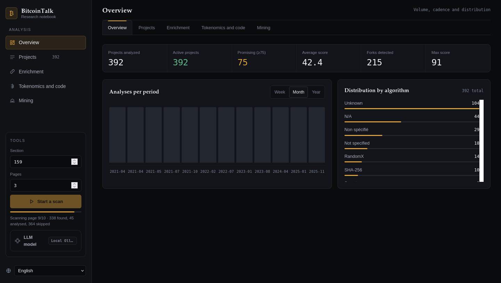
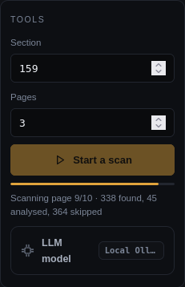
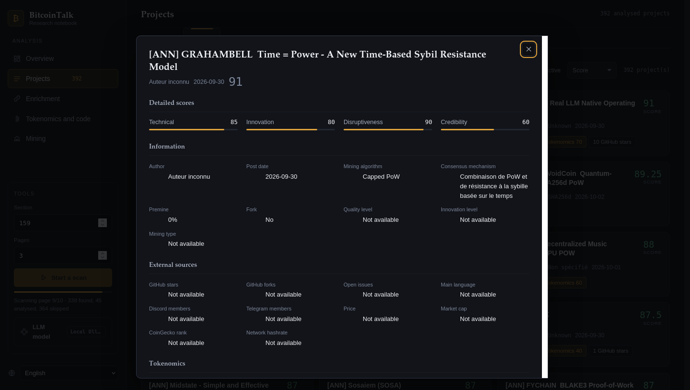
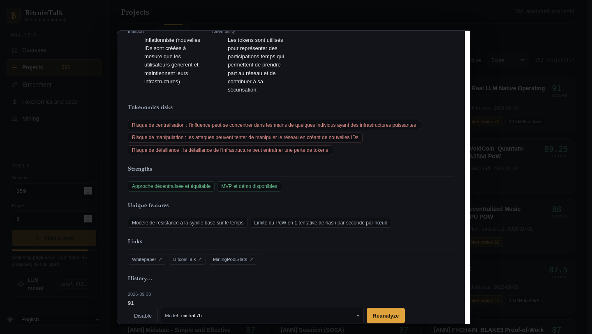

# BitcoinTalk Announcement Analyzer

A web application that analyzes BitcoinTalk forum announcements using LLMs for sentiment analysis, risk assessment, and detailed report generation.

## Features

- **Real-time Analysis**: Process BitcoinTalk thread announcements and extract key information
- **Model Selector**: Choose between different LLM models for analysis
- **Progress Tracking**: Monitor analysis progress with real-time updates
- **Multi-language Support**: English and French interfaces
- **Detailed Reports**: Comprehensive analysis including sentiment, risk level, and executive summaries

## Tech Stack

- **Backend**: Python 3, FastAPI/Uvicorn
- **Database**: SQLite
- **Frontend**: Vanilla JavaScript, HTML
- **LLM Integration**: Ollama (local, default) or any OpenAI-compatible API

## Installation

1. Clone the repository:
```bash
git clone <repository-url>
cd BitcoinTalkAnnonce
```

2. Create and activate virtual environment:
```bash
python3 -m venv venv
source venv/bin/activate
```

3. Install dependencies (if any):
```bash
pip install -r requirements.txt
```

4. Configure the LLM (optional — defaults to Ollama at `http://localhost:11434`):
either from the web interface (gear icon → LLM panel), or by creating
`llm_config.json` in the project root (path overridable via `BT_LLM_CONFIG`):
```json
{
    "provider": "ollama",
    "model": "llama3.1",
    "ollama_host": "http://localhost:11434",
    "api_base": "",
    "api_key": "",
    "temperature": 0.2,
    "timeout": 120
}
```
For an OpenAI-compatible API, use `"provider": "openai"` with `api_base`
(e.g. `https://api.openai.com/v1`) and `api_key`. The API key is stored in this
file only (never in the database) — keep it out of version control
(`llm_config.json` is git-ignored).

5. Run the application:
```bash
python dashboard.py
```

The server will start at `http://localhost:8080`

## API Endpoints

### `POST /api/scan`
Start a scan of a Bitcointalk section. Body: `{"section_id": 159, "pages": 5}`
(max 20 pages). Returns `202` with a `scan_id` if a scan starts, or `202` with
the running `scan_id` if one is already in progress.

### `GET /api/scan/status`
Live scan progress: `status` (`idle`/`running`/`done`/`error`), `pages_done`,
`topics_found`, `analyzed_count`, `skipped_count`.

### `POST /api/reanalyze/{topic_id}`
Trigger analysis of a BitcoinTalk thread announcement.

**Request Body (both fields optional):**
```json
{
    "model": "mistral:7b"
}
```

**Response:**
```json
{
    "ok": true,
    "topic_id": 1
}
```

## Usage

1. Open the web interface at `http://localhost:8080`
2. Pick a section and a page count in the sidebar, then start a scan
3. Watch live progress (pages scanned, topics found, analysed, skipped)
4. Open a project in the table to read its full report
5. Choose a model in the report footer and trigger a reanalysis if needed

## Screenshots

### Main Dashboard

*Overview with KPIs, charts by period and algorithm, and the scan controls in the sidebar*

### Progress Monitoring

*Live scan progress — pages scanned and current status in the tools panel*

### Analysis Report

*Project detail sheet: detailed scores, announcement information, external sources and code maturity*

### Model Selector

*Footer of the detail sheet: choose an AI model, then trigger a reanalysis*

## Configuration

### Database
The application uses SQLite for data storage. Database file is created automatically at `crypto_analysis.db` (project root).

### Language Support
- Interface available in English and French, selectable in the app and persisted per browser
- Server default language via the `APP_LANGUAGE` environment variable (defaults to `fr`)
- Translations available in `locales/en.json` and `locales/fr.json`
- Add new translations to maintain consistency across both locales

### LLM Models
- Default: Ollama, model `llama3.1` (any model installed locally is selectable
  in the interface — the list is read live from Ollama)
- OpenAI-compatible providers: any model name offered by your `api_base`

## Development

### Project Structure
- `dashboard.py` - Main FastAPI application
- `bitcointalk.py` - BitcoinTalk analysis logic
- `llm.py` - LLM providers (Ollama / OpenAI-compatible) and configuration
- `static/` - Frontend assets (HTML, CSS, JavaScript)
- `locales/` - Translation files (fr, en)
- `tests/` - Pytest suite
- `docs/screenshots/` - README screenshots

### Running Tests
```bash
source venv/bin/activate
python3 -m pytest tests/ -q
```

## License

[Specify your license here]

## Contributing

[Add contribution guidelines if applicable]